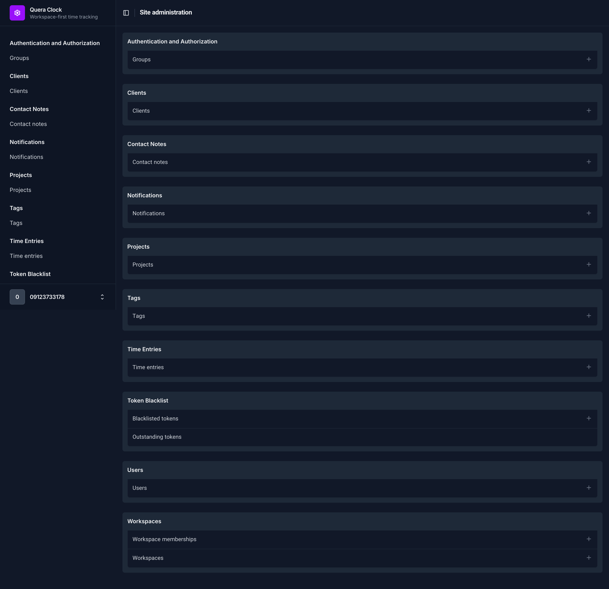
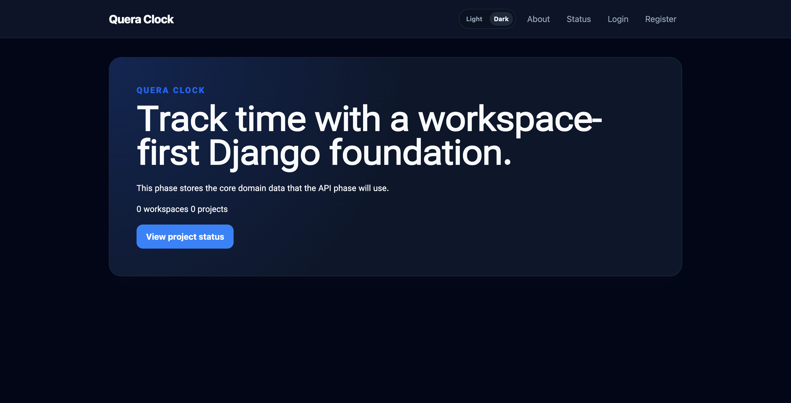

# Quera Clock Project

A Django REST Framework project developed through Quera's Django Backend Development Course, featuring project and time tracking management.

## Overview

The system is built around users, workspaces, and workspace memberships. Each workspace can have multiple members with different access levels, including owner, admin, manager, and member.

Authorized members can work with workspace-related resources such as clients, projects, and tags. Users can also record their working hours through time entries linked to a workspace and, optionally, a project or one or more tags.

Time entries can represent either active or completed tracking sessions and include additional properties such as billable status. The application supports searching, filtering, and organizing recorded working hours into grouped timesheet results.

Other parts of the application cover account management, profile customization, password operations, basic server-rendered pages, Django administration, contact form submissions, and event-driven notifications for selected workspace activities.

## Main Features

- **Authentication and Account Management:** A custom Django user model that uses mobile numbers as the primary authentication identifier. Includes registration, login, JWT token renewal, logout, profile management, profile image uploads, password updates, and user lookup.
- **Workspace Management:** Complete workspace creation, retrieval, modification, and deletion functionality, together with automatic owner assignment and role-based membership management.
- **Workspace Resources:** Management of clients, projects, and tags within individual workspaces. Supports search, filtering, sorting, image handling, project archiving and restoration, and soft deletion.
- **Time Tracking:** Starting and stopping timers, retrieving active entries, manually managing time records, associating projects and tags, marking entries as billable, and filtering records by different criteria.
- **Timesheet Processing:** Grouped time-entry responses and user-specific caching, with cache versioning to invalidate outdated results whenever time-entry data changes.
- **Notification System:** Notification retrieval, read/unread state management, unread counters, event-based notification creation, temporary SSE authorization tokens, and real-time notification streaming.
- **API Protection and Pagination:** Django REST Framework pagination and request throttling for anonymous users, authenticated users, and authentication-related endpoints.
- **Django Administration:** Administrative interfaces for managing users, workspaces, memberships, clients, projects, tags, time entries, contact notes, and notifications.
- **Web Interface:** A collection of server-rendered pages, including the landing page, about and contact sections, service status, dashboard preview, authentication pages, and user profile pages.

## Architecture and Application Design

The codebase follows a modular Django structure in which each application is responsible for a specific part of the domain.

- **`config/`** – Contains the main Django configuration, environment-specific settings, URL definitions, ASGI and WSGI entry points, and Celery initialization.
- **`apps/`** – Holds the main business applications. The `users` app handles account management and authentication, while `workspaces` manages workspace entities, memberships, roles, and access rules. Separate applications handle clients, projects, tags, and time entries. The `notifications` app is responsible for notification management and delivery, and `contact_notes` handles contact submissions and their administrative representation.
- **API modules** – Applications that expose REST endpoints organize their serializers, views, and URL patterns inside dedicated `api/` packages. Django REST Framework viewsets are used to implement common resource operations and additional domain-specific actions.
- **`core/`** – Provides reusable components shared across applications, including timestamp-related model functionality, soft-delete behavior, pagination utilities, and cache key management.

Access to workspace resources is controlled through model querysets and serializer-level validation. Whenever a new workspace is saved, a post-save signal automatically establishes its owner's membership. Notification-related operations are handled through service functions and Celery tasks.

## Repository Layout

```text
config/
  settings/          Base, development, and testing configurations
  urls.py             Main web and API URL routing
  celery.py           Celery application configuration

apps/
  users/              User accounts and authentication
  workspaces/         Workspace management and membership roles
  clients/            Client management
  projects/           Project management
  tags/               Tag management
  time_entries/       Time tracking and timesheet functionality
  notifications/      Notification handling, tasks, and SSE endpoints
  contact_notes/      Contact form and administrative models

core/                 Shared models, pagination, and cache utilities
templates/            Django HTML templates
static/               Static resources and CSS files
```

## Tech Stack

- Python 3
- Django 5.2
- Django REST Framework 3.15
- Simple JWT for REST authentication and token blacklisting
- SQLite as the configured local database
- Celery 5.4 with Redis as the configured broker and result backend
- Pillow for image fields and uploads
- `django-cors-headers`, `django-crispy-forms`, `crispy-bootstrap5`, and Django Unfold
- Django's test runner and Django REST Framework test utilities

## API

The API is routed from `config/urls.py`. DRF viewsets expose the standard list, detail, create, update, and delete operations where applicable. API requests use JWT bearer authentication unless an endpoint explicitly allows anonymous access.

### Authentication and Users

- `POST /api/users/register/`
- `POST /api/users/login/`
- `POST /api/users/token/refresh/`
- `POST /api/users/logout/`
- `GET|PUT|PATCH /api/users/me/`
- `POST|DELETE /api/users/profile/picture/`
- `GET /api/users/search/?mobile=...`
- `PATCH /api/users/password/change/`

Authentication endpoints are throttled at the dedicated auth rate. General anonymous and authenticated API throttles are also configured.

### Workspace Resources

- `/api/workspaces/` provides workspace CRUD and `GET /api/workspaces/{id}/my_role/`.
- `/api/memberships/` and `/api/workspace-memberships/` are two routes to the workspace membership viewset.
- `/api/clients/` provides client CRUD with workspace, search, and ordering filters.
- `/api/projects/` provides project CRUD, workspace/search/client/archive filters, and `{id}/archive/`, `{id}/unarchive/`, and `{id}/restore/` actions.
- `/api/tags/` provides tag CRUD with workspace, search, and ordering filters.

### Time Entries

`/api/time-entries/` provides time-entry CRUD plus:

- `POST /api/time-entries/start/`
- `GET /api/time-entries/running/`
- `POST /api/time-entries/{id}/stop/`
- `GET /api/time-entries/grouped/`

The list response uses the grouped timesheet representation. Filtering supports workspace, project, client, search, tags, running/ended status, start-time bounds, and selected ordering values.

### Notifications

`/api/notifications/` provides read-only notification list/detail routes and mark-read, mark-all-read, and unread-count actions. Additional endpoints are available at `/list/`, `/seen/`, `/seen/all/`, `/stream-token/`, and `/stream/` under that prefix.

## Background Processing and Notifications

Celery is initialized in `config/celery.py` and discovers tasks from installed Django apps. The notification app includes a task for creating a notification and a scheduled cleanup task that deletes read notifications older than 30 days. Celery Beat registers that cleanup task to run hourly.

The notification API issues a cache-backed stream token valid for five minutes. The SSE endpoint uses that token to authorize a short streaming response containing notification or ping events. In development and test settings, Celery tasks run eagerly; a separate worker and Beat process are only needed when exercising the normal Redis-backed asynchronous configuration.

## Testing

The repository contains ordinary Django tests in each app's `tests.py`, plus course check modules under app-specific `checks/` directories. The default Django discovery command currently finds the conventional `tests.py` files:

```bash
python manage.py test
```

The check modules use Django `TestCase` and DRF `APITestCase` classes and can be run explicitly, for example:

```bash
python manage.py test apps.users.checks.auth_api_tests
python manage.py test apps.notifications.checks.sse_api_tests
python manage.py test apps.time_entries.checks.cache_api_tests
```

The repository includes pytest configuration in `pyproject.toml`, but pytest is not listed in the project dependencies, so the documented test commands use Django's built-in runner.

## Screenshots

### Dashboard



### Workspace



## Installation & Setup

The default settings use SQLite and do not require environment variables for local development.

```bash
git clone <repository-url>
cd quera-clock-backend

python3 -m venv .venv
source .venv/bin/activate       # macOS/Linux

python -m pip install --upgrade pip
python -m pip install -r requirements.txt
python manage.py migrate
python manage.py runserver
```

The development server is available at `http://127.0.0.1:8000/`. The project uses the `development` settings selected by `manage.py`; these enable debug mode, local media serving, and eager Celery execution.

## Running Background Services

For normal development, the eager setting means a Redis service and separate Celery processes are not required for the standard web workflow. To exercise asynchronous Celery behavior, run Redis locally on its configured default port, then start the worker and Beat scheduler in separate terminals:

```bash
redis-server
celery -A config worker -l info
celery -A config beat -l info
```

The configured broker is `redis://localhost:6379/0` and the result backend is `redis://localhost:6379/1`.

## Development

```bash
python manage.py runserver
python manage.py test
python manage.py makemigrations
python manage.py migrate
```

Use the explicit test-module examples above when working on the course check files.

## Course Context

This repository was created as part of a Django backend course on Quera. Its features and structure reflect the incremental requirements and exercises introduced throughout the course. It is retained as a course and learning project.
